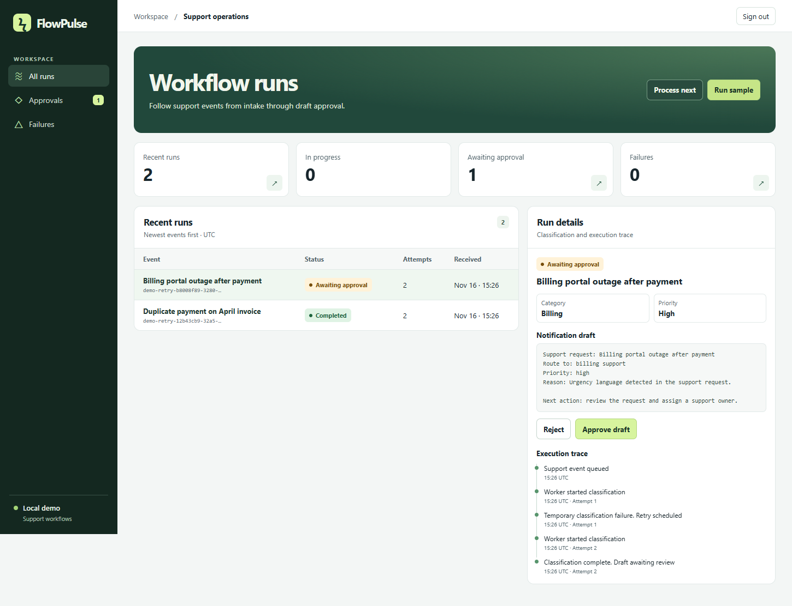

# FlowPulse

FlowPulse turns signed support events into tracked work. It classifies each request, prepares an internal notification draft and waits for an operator decision. Incoming webhooks return quickly while a background worker handles classification and retry.



## Run locally

Use Node.js 22.14+ and npm.

```sh
npm ci
cp .env.example .env
npm run dev
```

On PowerShell, use `Copy-Item .env.example .env`. Open [http://127.0.0.1:3000](http://127.0.0.1:3000). Select **Run sample** to create a synthetic event and see one deliberately failed classification attempt. After the retry, inspect the draft and select **Approve draft** or **Reject**. The dashboard shows the decision alongside the execution trace.

To exercise the real webhook signature and verify the same retry path with HTTP, leave the server running and use a second terminal.

```sh
npm run demo
```

The script prints the resulting run and leaves it in the approval queue. Pass `npm run demo -- --approve` to record an approval for that synthetic event from the terminal. Run `npm run worker` to poll for new work every two seconds, or use **Process next** to claim one job in the demo dashboard.

## Architecture

Next.js and React serve the dashboard and REST API. The queue and approval state live in PostgreSQL. PGlite uses the same schema and queries for the local single-process setup. Zod validates webhook and model payloads. Trigger.dev can run the worker on an hourly schedule. [Architecture and state transitions](docs/architecture.md).

## HTTP API

| Method and path | Authorization | Result |
| --- | --- | --- |
| GET `/api/health` | Public | Application liveness |
| POST `/api/events` | Timestamped HMAC | 202 with a new run ID, or 200 for a matching replay |
| GET `/api/runs` | Operator bearer token | Latest 100 runs and provider label |
| GET `/api/runs/{id}` | Operator bearer token | Run status, draft and trace |
| POST `/api/runs/{id}/decision` | Operator bearer token | Updated run after `{"decision":"approve"}` or `{"decision":"reject"}` |
| POST `/api/worker/tick` | Worker bearer token | Processes one eligible run or returns `idle` |

A signed event body has four fields.

```json
{
  "id": "support-123",
  "type": "support.requested",
  "subject": "Billing portal outage",
  "body": "The payment dashboard is unavailable."
}
```

Send it as `application/json` with `X-FlowPulse-Timestamp` set to Unix time in seconds. Set `X-FlowPulse-Signature` to `sha256=` followed by the hex HMAC-SHA256 of the timestamp, a period and the original UTF-8 request bytes. A webhook body is limited to 16 KiB. A replay with a conflicting payload returns 409. [Executable webhook example](scripts/demo.mjs).

## Configuration

| Variable | Purpose |
| --- | --- |
| `DEMO_MODE` | Enables the sample and loopback demo credentials. Set to `false` on a deployed app. |
| `OPERATOR_TOKEN`, `WORKER_TOKEN`, `WEBHOOK_SECRET` | Distinct random credentials at least 32 characters long when demo mode is off. |
| `DATABASE_URL` | External PostgreSQL connection URL. |
| `DATABASE_PATH` | Embedded PostgreSQL path when `DATABASE_URL` is unset. Defaults to `data/flowpulse`. |
| `AI_PROVIDER` | Defaults to `rules` and makes zero model calls. `openai` opts in to a compatible Chat Completions endpoint. |
| `AI_ENDPOINT`, `AI_MODEL`, `AI_API_KEY` | HTTPS endpoint, model and secret for the opt-in provider. Submitted subject and message are sent to that endpoint. |
| `FLOWPULSE_URL` | Base app URL for the worker, demo script and hosted scheduler. |
| `TRIGGER_PROJECT_REF` | Trigger.dev project reference for task deployment. |

To use Docker Compose, copy the env example and add a URL-safe random `FLOWPULSE_DB_PASSWORD`. Run `docker compose up --build`. The service binds to loopback and uses a persistent PostgreSQL volume. Run the local poller separately or configure the scheduler.

For Trigger.dev, deploy the app behind HTTPS and set `WORKER_TOKEN` and `FLOWPULSE_URL` in the Trigger.dev environment. Set `TRIGGER_PROJECT_REF` for the CLI and deploy the task with `npx trigger.dev@4.8.5 deploy`. The hourly job claims up to 20 eligible runs and uses the same worker endpoint as the local poller. The hosted schedule and the paid model path require user-provided accounts and credentials.

## Verification

```sh
npm test
npm run lint
npm run typecheck
npm run build
npm audit --audit-level=moderate
```

Tests use an isolated in-memory PostgreSQL instance by default. For the server-mode tests, set `TEST_DATABASE_URL` to a dedicated disposable PostgreSQL database. The test suite clears its `runs` table between cases. GitHub Actions runs the same suite against PostgreSQL 17.

## Scope and original work

This MVP supports one event type and one shared operator role. It snapshots the latest 100 runs and stores draft decisions. Notification delivery, organization-level permissions, and a retention workflow are outside this version. Deploy with TLS, a dedicated database and rate limits at the ingress. Container and hosted scheduler configuration are included. The local demo does not require a container daemon, paid provider or account.

Original work includes raw-body webhook verification, replay-safe ingestion, expiring PostgreSQL worker leases, bounded retries, structured classification and the operator review dashboard. The Trigger.dev examples informed the scheduler integration. [Third-party notices](THIRD_PARTY_NOTICES.md) · [MIT license](LICENSE).
