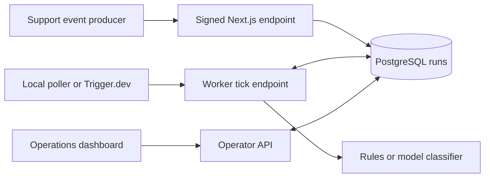

# Architecture

A run contains a normalized event, classification, draft and bounded transition history. The event ID is unique. A replay with the same normalized payload returns the existing run, while reuse of the ID with a different payload returns HTTP 409. Intake checks the HMAC against the original bytes and accepts timestamps up to five minutes away from the server clock.

Workers claim eligible runs atomically with row locks and SKIP LOCKED. Claiming increments attempts and allocates a new 60-second lease token. Finalizing an attempt requires the same unexpired token. A replacement worker may reclaim an expired lease. An expired third attempt becomes failed. Temporary provider failures become eligible again after two seconds on attempt one and four on attempt two. The polling interval or schedule controls when the retry is actually claimed.

A successful classifier result moves the run into the approval queue. The decision and its trace entry are written atomically. Repeating the same decision is idempotent, and a conflicting decision returns HTTP 409. Approval changes the stored run to completed. The integration stops at a persisted notification draft.

The operator, worker and webhook credentials are separate. Operator responses omit the submitted message body and model credentials. The server logs stable event codes for infrastructure issues. The hosted classifier, when enabled, receives the submitted subject and body. The default rule classifier works offline.

Embedded PostgreSQL is intended for one local app process. Use a dedicated PostgreSQL database for multiple workers or containerized deployments. Schema creation is automatic for this single-schema MVP.
