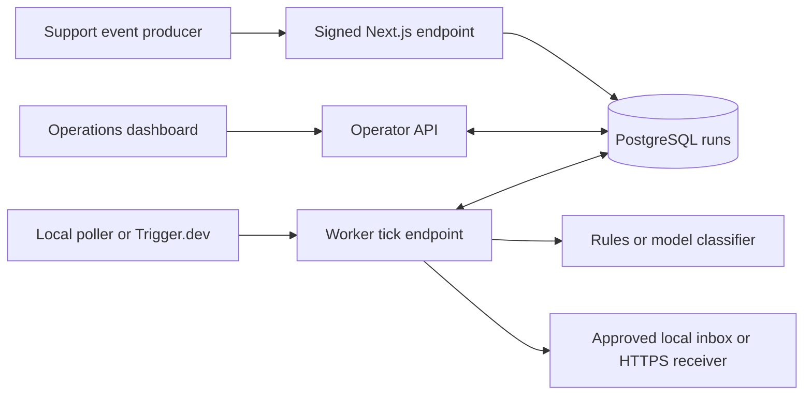

# Architecture

A run contains a normalized event, classification, draft and bounded transition history. The event ID is unique. A replay with the same normalized payload returns the existing run, while reuse of the ID with a different payload returns HTTP 409. Intake checks the HMAC against the original bytes and accepts timestamps up to five minutes away from the server clock.

Workers claim eligible runs atomically with row locks and SKIP LOCKED. Claiming increments attempts and allocates a new 60-second lease token. Finalizing an attempt requires the same unexpired token. A replacement worker may reclaim an expired lease. An expired third attempt becomes failed. Temporary provider failures become eligible again after two seconds on attempt one and four on attempt two. The polling interval or schedule controls when the retry is actually claimed.

A successful classifier result persists routing and the proposed action, then moves the run into the approval queue. Approval atomically queues delivery when a destination is configured. Rejection terminates the run. Repeating a decision is idempotent, and a conflicting decision returns HTTP 409. The next worker claims delivery separately, checks the stored destination against its configuration and posts the approved draft using the run ID as the idempotency key.

Each queued stage has its own automatic attempts. Exhausted or permanent failures remain visible for operator review. An operator can manually requeue a failed stage up to three times and cancel pending work. A cancellation stops further attempts. An earlier delivery attempt can already have reached the receiver if its acknowledgement was lost. Delivery completion requires a successful receiver acknowledgement and an active worker lease.

The operator, worker and webhook credentials are separate. Operator responses omit the submitted message body and model credentials. The server logs stable event codes for infrastructure issues. The hosted classifier, when enabled, receives the submitted subject and body. The default rule classifier works offline.

Embedded PostgreSQL is intended for one local app process. Use a dedicated PostgreSQL database for multiple workers or containerized deployments. Startup adds workflow-stage and telemetry columns to older databases. Existing runs remain readable with their original classifications and decisions.
